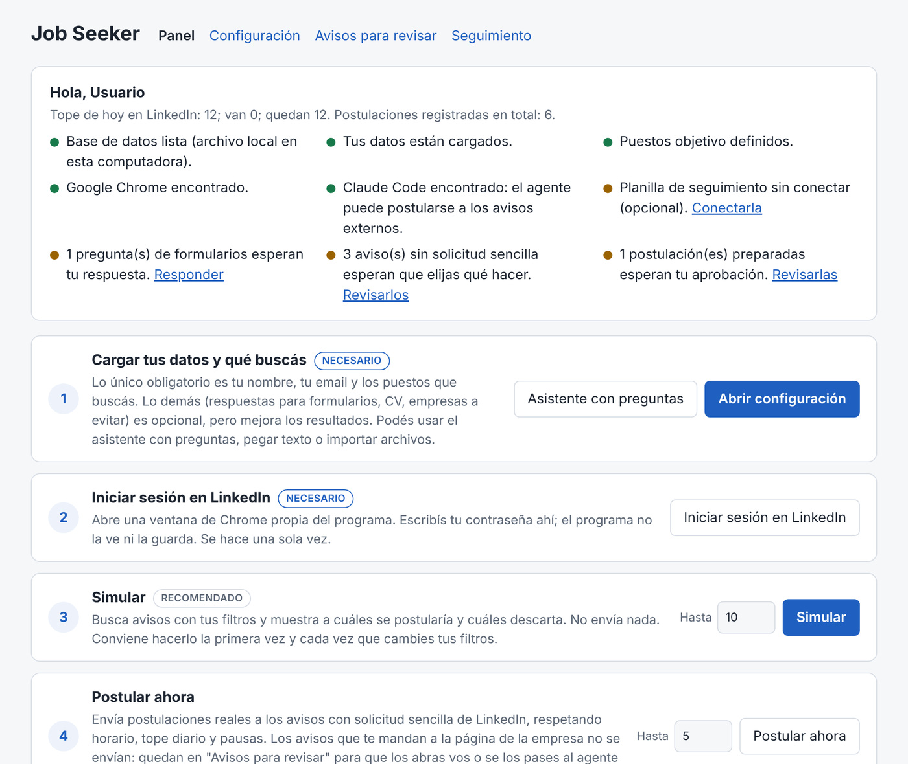
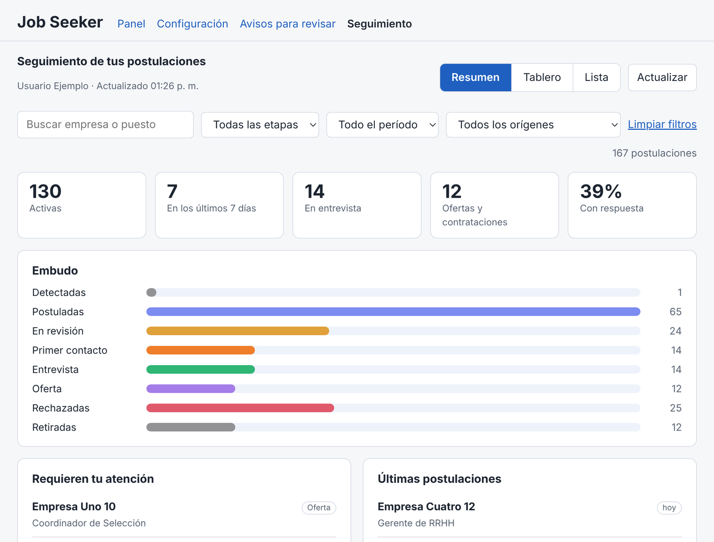
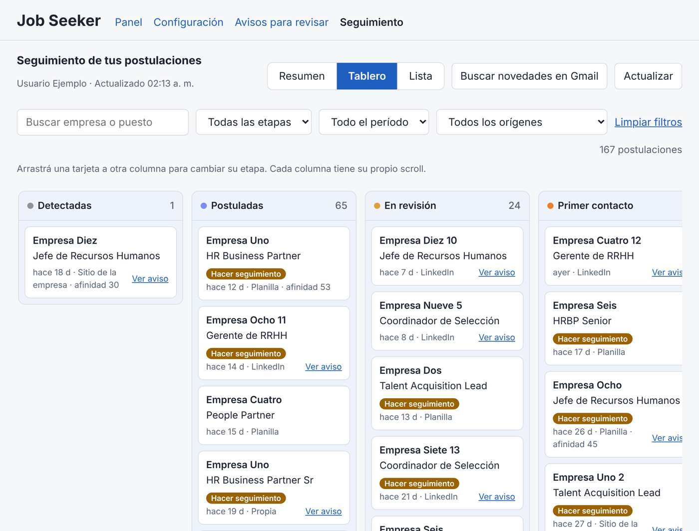
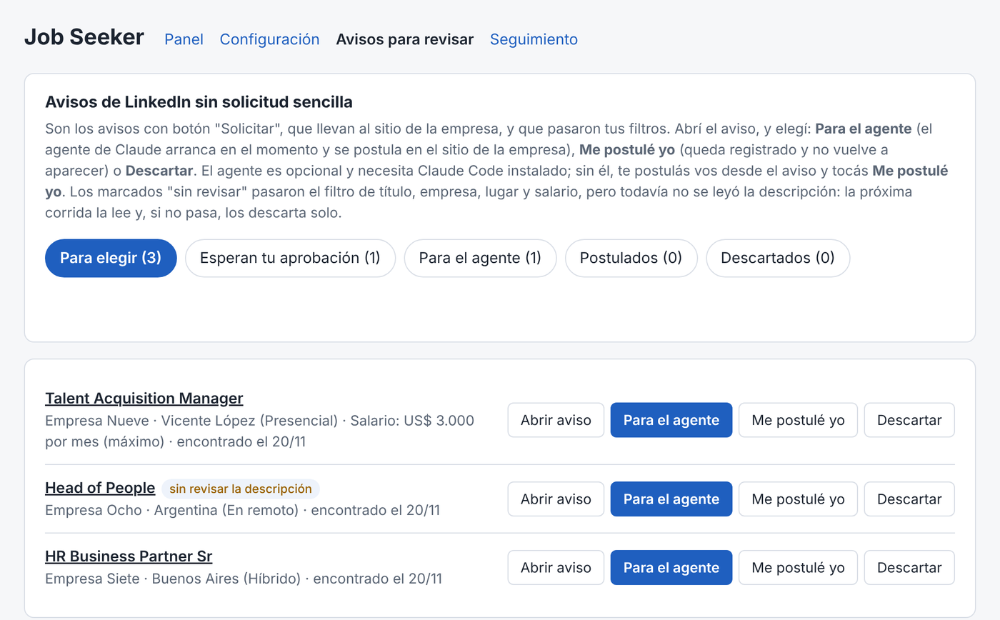
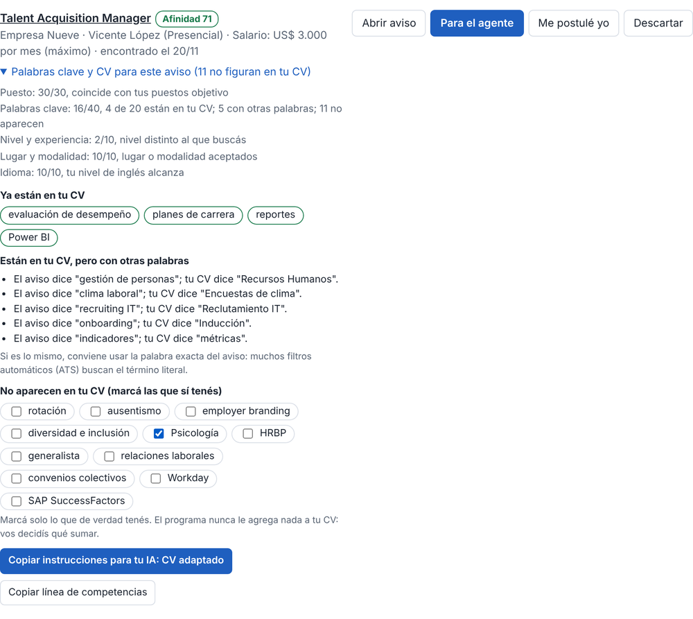
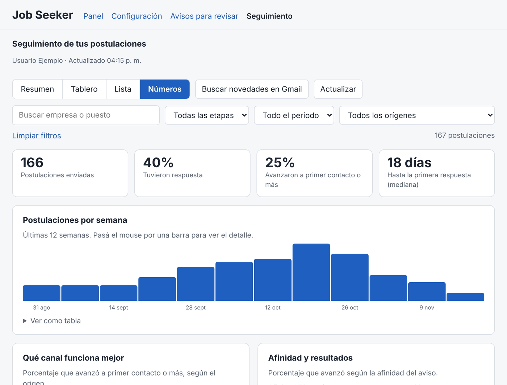
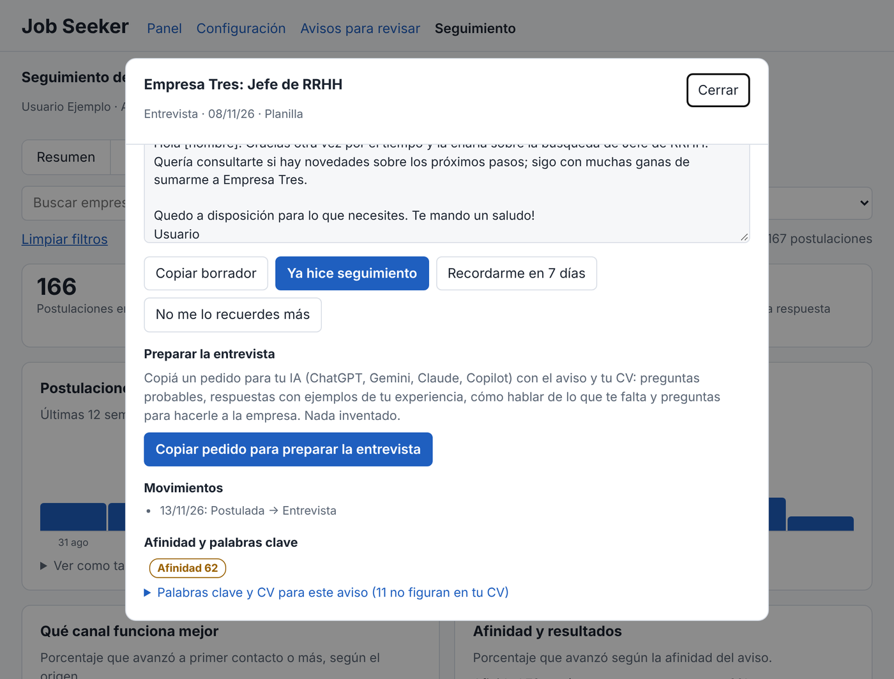
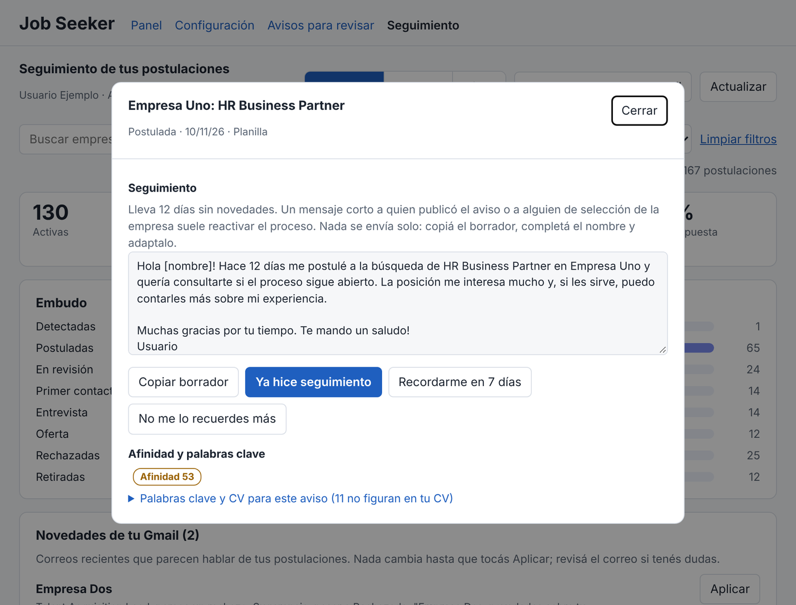
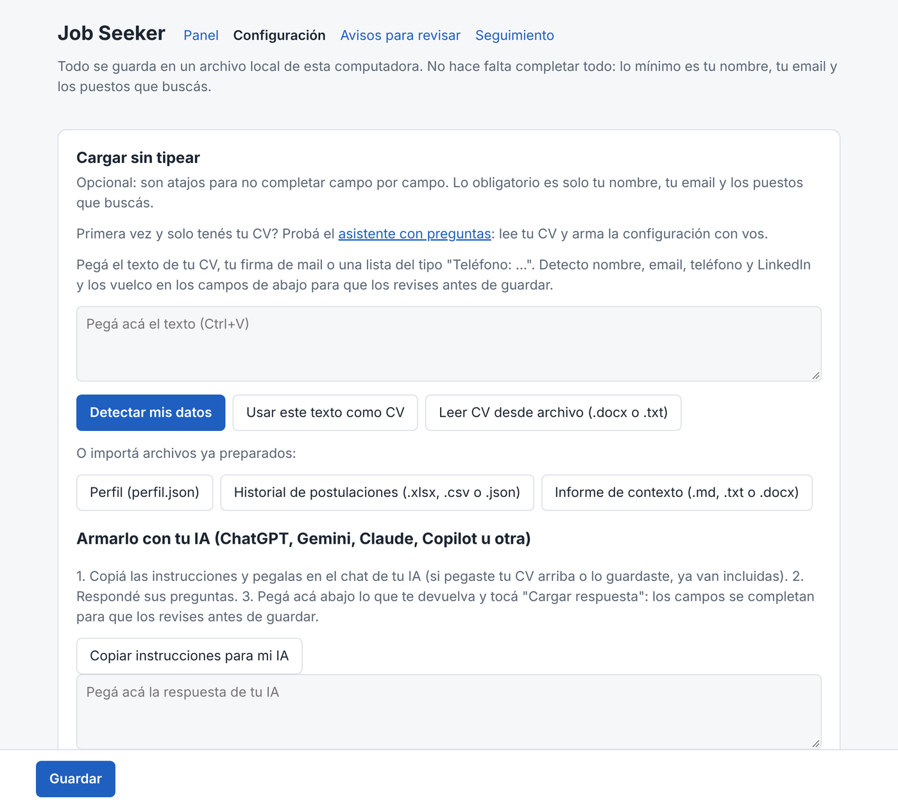

# Job Seeker

**Tu asistente para buscar trabajo en LinkedIn.** Busca avisos según lo que querés, descarta los que no van, se postula por vos a los de Solicitud sencilla y te ordena el seguimiento de cada postulación. Funciona en tu computadora, con tus datos y bajo tu control.

Gratis para uso personal.

### [Descargar para Windows (.zip)](https://github.com/Andyvazquezsanchez/AV-job-seeker/releases/latest/download/JobSeeker-Windows.zip)

[Manual "Cómo comenzar" (PDF, 7 páginas)](docs/Job-Seeker-Como-comenzar.pdf) · [Guía completa (PDF)](docs/Job-Seeker-Guia-completa.pdf) · [Todas las versiones](https://github.com/Andyvazquezsanchez/AV-job-seeker/releases)



---

## Qué hace

- **Arranca fácil.** Subís tu CV (PDF o Word) y respondés unas preguntas simples: el asistente arma tu búsqueda. La vista simple te guía paso a paso; la avanzada te deja personalizar todo.
- **Busca avisos en LinkedIn** con los puestos, lugares y palabras que vos definís.
- **Filtra** los que no van: empresas que querés evitar, puestos de otro nivel, avisos presenciales lejos de donde vivís.
- **Se postula solo a los avisos con Solicitud sencilla**, completando los formularios con tus datos y eligiendo el CV adecuado (por ejemplo, en inglés si el aviso está en inglés).
- **Te deja para revisar los avisos que llevan al sitio de la empresa** (botón "Solicitar"). Los abrís vos o, si querés, se los pasás a un agente de IA para que prepare la postulación.
- **Trae avisos de otras fuentes** para que elijas: páginas de empleo de empresas que usan Greenhouse, Lever o Ashby, y Computrabajo, Bumeran y ZonaJobs.
- **Te dice qué tan bien encaja cada aviso** (afinidad de 0 a 100) y **qué palabras clave pide que tu CV no dice**. Con un botón copiás un pedido para tu IA que arma un CV adaptado a ese aviso, sin inventar nada.
- **Ordena tu seguimiento** en cuatro vistas (Resumen, Tablero, Lista y Números). Cuando te llama una empresa, arrastrás la tarjeta a la etapa nueva, y con un botón copiás un pedido para que tu IA te ayude a preparar la entrevista.
- **Te recuerda cuándo hacer seguimiento**, con un borrador de mensaje que adaptás y enviás vos.
- **Lee las novedades de tu Gmail** (solo la lista de correos) y te sugiere cambios de etapa: un rechazo, una invitación a entrevista. Los aplicás vos.
- **Puede trabajar en automático** los días y horarios que elijas, con un tope diario.

### Novedades de la versión 1.3

- Vista simple para empezar: arriba a la derecha del panel elegís "Simple" (los pasos básicos, guiados) o "Avanzada" (todas las opciones). En Configuración, la simple muestra primero lo básico.
- El asistente lee tu CV en PDF o en Word, en tu computadora, y conserva lo que ya tenías cargado. El nivel ahora hay que elegirlo.
- Preguntas que suelen hacer los formularios (si podés trabajar legalmente, si necesitás visa, título, mudanza, viajes, registro): las respondés una vez y el programa ya no frena por ellas.
- Se descartan los avisos que parecen estafas: piden plata, pagan "tareas" por día, piden contacto por Telegram o que inviertas.
- Los filtros comparan como una persona: sin importar mayúsculas, tildes, plural o femenino, con abreviaturas (Sr, Ssr, RRHH, HRBP), palabras que se usan para lo mismo y un error de tipeo en palabras largas. En los puestos objetivo también cuentan las traducciones (RRHH y HR, reclutador y recruiter). Una entrada entre comillas se compara tal cual.
- Consejos en la vista simple para que la búsqueda rinda más.
- El instalador deja el acceso directo en el Escritorio y también en el menú Inicio, y se frena si lo abrís desde adentro del .zip.

### Novedades de la versión 1.2.1

- Antigüedad aparte para Computrabajo, Bumeran y ZonaJobs en Configuración (vacío = la misma que LinkedIn). LinkedIn y los portales aceptan también "últimos 2 días" y "últimos 3 días".
- "Postular ahora" pide tres cantidades: postulaciones en LinkedIn y cuántos avisos nuevos traer de Computrabajo, Bumeran y ZonaJobs y de páginas de empresas (0 = no buscar).
- Los portales no traen avisos a los que ya te postulaste: los de tu seguimiento, los de tu planilla y, si iniciaste sesión en el sitio dentro de la ventana del programa, los que el sitio marca como "Ya aplicaste" o "Postulado".
- Arreglos: Bumeran y ZonaJobs leen bien cada aviso (título, empresa, lugar y fecha), la descripción de Computrabajo ya no trae búsquedas relacionadas y las notificaciones de Windows aparecen.

### Novedades de la versión 1.2

- Otras fuentes de avisos en "Avisos para revisar": páginas de empleo de empresas (Greenhouse, Lever, Ashby) y Computrabajo, Bumeran y ZonaJobs. Ninguna se postula sola.
- "Postularme con mi IA": copia un pedido para que tu IA te ayude a completar un formulario con tus respuestas guardadas, sin inventar.
- "Preparar la entrevista": un pedido para tu IA con el aviso y tu CV.
- Vista "Números" en Seguimiento: postulaciones por semana y qué canal y qué afinidad te traen más respuestas.
- Avisos de Windows al terminar la corrida automática o si LinkedIn hace frenar al programa.
- La clave que cifra las contraseñas de sitios queda protegida con tu usuario de Windows.

El detalle está en la [guía completa](docs/Job-Seeker-Guia-completa.pdf), capítulos 13, 14, 17 y 18.

### Novedades de la versión 1.1

Afinidad y palabras clave por aviso, CV adaptado con tu IA, recordatorios de seguimiento, novedades de Gmail, pausa de seguridad si LinkedIn muestra un captcha o un aviso, arranque gradual las primeras dos semanas y postulación automática sin ventana negra. El detalle está en la [guía completa](docs/Job-Seeker-Guia-completa.pdf), capítulos 13, 16 y 17.

## Lo que tenés que saber

- **Nunca inventa.** Si un formulario pregunta algo que no cargaste, no envía esa postulación y te muestra la pregunta para que la respondas una sola vez.
- **Todo queda en tu computadora.** No hay cuentas, servidores ni suscripciones. El programa no ve tu contraseña de LinkedIn: la escribís vos en la ventana de LinkedIn.
- **Nunca toca tu CV ni tus correos.** Te muestra lo que falta y lo que llegó; vos decidís qué cambiar.
- **Sobre LinkedIn:** automatizar postulaciones va contra sus condiciones de uso y la cuenta puede ser restringida. Los límites del programa (horario, tope diario, arranque gradual, pausas entre postulaciones y una pausa de varios días si LinkedIn muestra un captcha o un aviso) reducen ese riesgo pero no lo eliminan. Empezá de a poco.

## Qué necesitás

- Una computadora con **Windows 10 u 11**.
- **Google Chrome** instalado.
- Tu cuenta de **LinkedIn**.

Nada más: el resto viene incluido en la descarga.

## Descarga e instalación

1. **Descargá** el archivo [`JobSeeker-Windows.zip`](https://github.com/Andyvazquezsanchez/AV-job-seeker/releases/latest/download/JobSeeker-Windows.zip).
2. **Descomprimilo en un lugar fijo**, por ejemplo en Documentos: clic derecho sobre el archivo y "Extraer todo". No lo abras desde adentro del .zip.
3. **Abrí la carpeta `JobSeeker` y hacé doble clic en `Instalar.bat`.** Se abre una ventana negra que muestra lo que hace; tarda menos de un minuto.
   > Si aparece un cartel azul que dice "Windows protegió su PC", es normal con archivos bajados de internet: tocá **"Más información"** y después **"Ejecutar de todas formas"**.
4. **Listo.** Queda un acceso directo **Job Seeker** en el Escritorio y otro en el menú Inicio. Cada vez que quieras usar el programa, abrilo desde cualquiera de los dos.

Al abrirlo se abren dos cosas: el **panel** en tu navegador y una **ventana negra** minimizada. Mientras la ventana negra esté abierta, el programa funciona; para apagarlo, cerrala.

## Primeros pasos

El panel tiene los pasos numerados, y cada uno dice si es necesario, recomendado u opcional.

1. **Cargá tus datos.** Lo único obligatorio es tu nombre, tu email y los puestos que buscás. Para no completar campo por campo, tenés un asistente con preguntas, plantillas por área (RRHH, Administración, Tecnología, Comercial, Marketing y Operaciones) y la opción "Armarlo con tu IA".
2. **Iniciá sesión en LinkedIn** en la ventana que abre el programa. Se hace una sola vez.
3. **Simulá.** Te muestra a qué avisos se postularía y por qué descarta los otros, sin enviar nada.
4. **Postulá de a poco.** La primera vez, 1 o 2 postulaciones. Revisá en LinkedIn que hayan salido bien.
5. **Opcional:** dejalo en automático en los días y horarios que elijas.

El paso a paso con imágenes está en el manual [Cómo comenzar](docs/Job-Seeker-Como-comenzar.pdf).

## Si no sabés por dónde empezar, pedile ayuda a tu IA

Copiá este texto y pegalo en la IA que uses (ChatGPT, Gemini, Claude, Copilot u otra). Te va a guiar paso a paso, a tu ritmo.

```text
Quiero instalar y empezar a usar Job Seeker, un programa gratuito para Windows que me ayuda a buscar trabajo y postularme en LinkedIn. Su página es https://github.com/Andyvazquezsanchez/AV-job-seeker (si podés abrir enlaces, leela antes de empezar).

Guiame como si nunca hubiera instalado un programa así:
- Dame un solo paso por vez y esperá a que te diga "listo" antes de seguir.
- Usá palabras simples. Si tenés que usar un término técnico, explicalo.
- Si te cuento lo que veo en la pantalla o te mando una captura, decime qué tocar.

Los pasos, en este orden:
1. Verificar que tengo Windows 10 u 11 y Google Chrome instalado.
2. Descargar JobSeeker-Windows.zip desde https://github.com/Andyvazquezsanchez/AV-job-seeker/releases/latest/download/JobSeeker-Windows.zip
3. Descomprimirlo en Documentos (clic derecho, "Extraer todo"), sin abrirlo desde adentro del .zip.
4. Abrir la carpeta JobSeeker y hacer doble clic en Instalar.bat. Si aparece el cartel azul "Windows protegió su PC", tocar "Más información" y "Ejecutar de todas formas".
5. Abrir el acceso directo "Job Seeker" del Escritorio o del menú Inicio. Se abre un panel en el navegador y una ventana negra que no tengo que cerrar.
6. Cargar mis datos en el panel. Lo obligatorio es nombre, email y los puestos que busco. Ayudame a elegir los puestos y las palabras clave según mi perfil, que te voy a contar. Si uso la opción "Armarlo con tu IA" del programa, te voy a pegar unas instrucciones: seguilas.
7. Iniciar sesión en LinkedIn desde el paso 2 del panel y después tocar "Simular" para ver qué avisos elegiría, sin enviar nada.

Importante: nunca me pidas mi contraseña de LinkedIn ni de ningún otro sitio; la escribo yo directamente en la ventana de LinkedIn. Si algo falla, preguntame qué dice el mensaje antes de proponerme una solución.
```

## Cómo se ve

| Seguimiento: vista Resumen | Seguimiento: vista Tablero |
|---|---|
|  |  |

| Avisos para revisar | Palabras clave de un aviso |
|---|---|
|  |  |

| Seguimiento: vista Números | Preparar la entrevista |
|---|---|
|  |  |

| Detalle y recordatorio de seguimiento | Configuración |
|---|---|
|  |  |

*Capturas con datos de ejemplo.*

## Preguntas frecuentes

**Es gratis?**
Sí, para uso personal. No tiene suscripciones ni pagos.

**Sirve solo para Recursos Humanos?**
No. Trae plantillas para varias áreas y podés buscar cualquier puesto: los puestos, las palabras clave y los idiomas los definís vos.

**Funciona en Mac?**
Por ahora la descarga es para Windows. En Mac y Linux se puede usar desde la terminal (ver [MANUAL.md](MANUAL.md)), pero no está probado en Mac.

**Se actualiza solo?**
No, a propósito: nada cambia sin que vos lo decidas. Cuando haya una versión nueva, la vas a encontrar en [Versiones](https://github.com/Andyvazquezsanchez/AV-job-seeker/releases).

**Qué pasa con los avisos que llevan al sitio de la empresa?**
Quedan en "Avisos para revisar". Ahí elegís si te postulás vos (con ayuda de tu IA, si querés), si los descartás o, si instalaste Claude Code (opcional), si se los pasás al agente de IA. Antes de enviar, el agente te pide tu aprobación.

**Busca en otros sitios además de LinkedIn?**
Sí, desde la versión 1.2: páginas de empleo de empresas que usan Greenhouse, Lever o Ashby, y Computrabajo, Bumeran y ZonaJobs. Esos avisos no se postulan solos: te quedan para elegir.

**Algo no anda.**
Mirá el capítulo "Problemas frecuentes" de la [guía completa](docs/Job-Seeker-Guia-completa.pdf). Si no lo encontrás ahí, abrí un [issue](https://github.com/Andyvazquezsanchez/AV-job-seeker/issues) contando qué pasó y qué mensaje viste, sin incluir datos personales.

## Documentación

- [Cómo comenzar](docs/Job-Seeker-Como-comenzar.pdf): lo indispensable, en pocas páginas.
- [Guía completa](docs/Job-Seeker-Guia-completa.pdf): explicaciones, problemas frecuentes y glosario.
- [MANUAL.md](MANUAL.md): referencia completa en texto, con los comandos.
- [AGENTS.md](AGENTS.md): reglas para usarlo con un agente de IA.

## Licencia

Job Seeker es **gratuito para uso personal** y **está prohibido venderlo** o usarlo con fines comerciales sin permiso del autor. Podés copiarlo, compartirlo y modificarlo, siempre gratis y con el archivo [LICENSE](LICENSE) incluido.

Las partes creadas por Andy Vázquez Sánchez tienen licencia [PolyForm Noncommercial 1.0.0](https://polyformproject.org/licenses/noncommercial/1.0.0), con un permiso explícito para usarlo en la propia búsqueda laboral. El código original del que parte tiene licencia MIT. Los textos completos están en [LICENSE](LICENSE).

## Créditos y agradecimiento

Job Seeker fue desarrollado por **Andy Vázquez Sánchez**, que lo adaptó, amplió y personalizó a partir del proyecto de código abierto [job-seeker](https://github.com/galiprandi/job-seeker) de **Germán Aliprandi**. Gracias, Germán, por publicarlo.

Este programa nació de una búsqueda laboral real y de las ganas de que buscar trabajo sea un poco menos agotador. Ojalá te ayude a llegar a la entrevista que estás esperando.

Si querés contarme cómo te fue, sugerir una mejora o simplemente conectar: [linkedin.com/in/avazquezsanchez](https://www.linkedin.com/in/avazquezsanchez)
